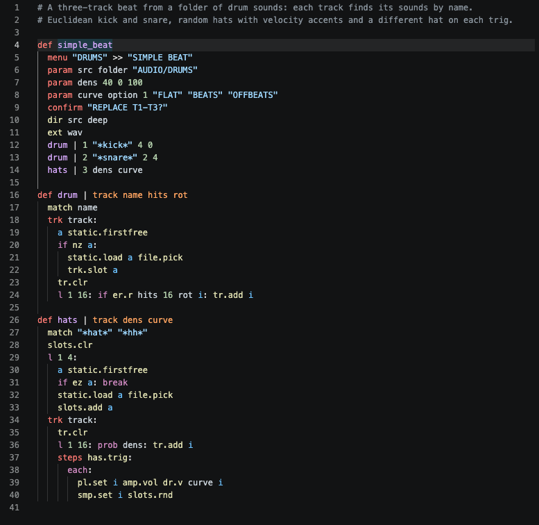
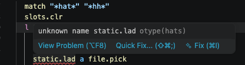
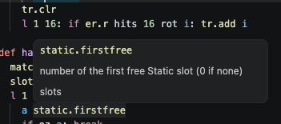
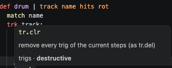
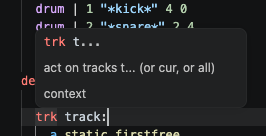

<p align="center">
  
</p>

<h2 align="left"><a href="https://nordseele.github.io/otype-docs/">Read the documentation</a></h2>

<p align="center">
  <a href="https://nordseele.github.io/otype-docs/learn/"><b>Learn</b></a> ·
  <a href="https://nordseele.github.io/otype-docs/"><b>Command reference</b></a> ·
  <a href="https://nordseele.github.io/otype-docs/cookbook.html"><b>Cookbook</b></a> ·
  <a href="https://nordseele.github.io/otype-docs/roadmap.html"><b>Roadmap</b></a> ·
  <a href="#faq"><b>FAQ</b></a>
</p>

# OType

**Scripting for the Octatrack.** One command per line. (Almost) every editable parameter within
reach, audio files included. Drop scripts on the card and call them on the machine.

```ruby
def four_floor
  menu "BASICS" >> "FOUR FLOOR"
  confirm "REPLACE TRIGS?"
  tr.clr
  l 1 16: if eq mod i 4 1: tr.add i
```

<sub>A whole script: a menu entry, a YES/NO, then a kick on every beat of the current track.</sub>

A live script runs with the sequencer instead: the [drum and bass recipe](https://nordseele.github.io/otype-docs/cookbook.html#14-drum-and-bass-on-eight-tracks)
plays the eight tracks from eight Static slots, a 32-bar arrangement with a breakdown, random ghosts and accents,
and two filters that move on their own.

OType is a language and an engine for custom firmware: it runs inside a firmware that integrates it, such as
[OT1](https://github.com/nordseele/ot1). See [who it is for](#who-it-is-for-today).

OType is developed by Octalab / Nordseele on the Elektron Octatrack MKI (OS 1.40C); it has not been tested on the
MKII. A script is a short text file in `/SCRIPTS/` on the CF card; the unit compiles it itself when the scripts are
loaded. To change a function, edit the file and load it again: the firmware is not rebuilt.

## What a script can reach

We tried to cover everything you can edit on the Octatrack:

- **trigs** of every kind: sample trigs, trigless, one-shot, swing and slide trigs; trig conditions, micro-timing,
  retrigs;
- **locks**: parameter locks and sample locks;
- **the pages**: playback, AMP, LFO, FX1 and FX2, track levels; **parts** and **scenes**; tempo, patterns and banks;
- **machines and sample slots**, Static and Flex: load, free, find the first free slot, swap;
- and, beyond what the stock editing offers, **audio files on the card**: save the current take as a WAV, load it
  straight into a slot, build a sliced chain from a folder (with its `.ot` slices), normalise a folder through the
  `.ot` gain without rewriting the audio.

The full list, by category, is the [command reference](https://nordseele.github.io/otype-docs/).

## What's new in 1.1

A script can now run with the sequencer, not only on a press:

- **live scripts** — `in clock`, `in note`, `in cc`, `in trig`; `var` keeps state between runs; `launch 384` starts on the bar;
- **MIDI** — `send.note`, `send.cc`, `send.prog`, `send.nrpn` out; `midi.note`, `midi.vel`, `midi.cc` in; `param … cc` follows a knob;
- **the recorder** — `rt.add`, `rec.src`, `rec.len`, and `rec.arm`, which starts a take now from the inputs, MAIN, CUE or a track;
- **patterns and links** — `pat.copy`, and `gate` / `in gate` / `out` / `cv` to wire one script to another.

```ruby
def grab_now
  in trig 1 all:
    if and eq trig.hit 1 eq trig.step 1: rec.arm 1
```

<sub>The trig on step 1 starts a take; RECORDING SETUP sets its source and its length.</sub>

Compatibility: `module` is refused (write `in clock n`); the names `in`, `var`, `launch`, `gate`, `out` and `cv` are reserved.

## Coming in 1.2

Not in this version yet:

- scripts that start by themselves when a project loads (`auto`, `in load:`, the project's own `SCRIPTS` folder);
- trigs sent by another firmware (`in trig t script:`);
- the audio operators as an optional package, OType audio.

## Learn the language

The documentation teaches OType from the beginning. **[Learn](https://nordseele.github.io/otype-docs/learn/)** is a series of short studies, each
building something you can hear: a quickstart, then expressions, decisions and loops, variables, tracks and steps,
functions, the player's settings, randomness, live scripts and errors. Every listing passes the checker, with the
simulator's output under it.

- **[Cookbook](https://nordseele.github.io/otype-docs/cookbook.html)**: more than thirty recipes, one need each, every one of them tested.
- **[Command reference](https://nordseele.github.io/otype-docs/)**: every operation, its arguments and an example.
- **[Language reference](docs/syntax.md)**: every rule in full, for those who implement or integrate OType.

## Writing scripts

Unlike Teletype, scripts cannot be typed on the machine itself. We would have liked that, but the Octatrack has no
port for a keyboard. Scripts are written on a computer and copied to the card; these tools make that quick:

- **A VS Code extension** (`editors/vscode/`) checks your script as you type, with the very rules the unit applies,
  and gives completion, signature help, hover documentation, go to definition and snippets.
- **A checker and a simulator** on the computer run a function on a real bank file from your card and show you the
  resulting steps before anything touches the unit.
- **An error only refuses its own function**: everything else in the file still loads, exactly as on the unit.
- The **[cookbook](https://nordseele.github.io/otype-docs/cookbook.html)** gives short recipes, one need each, every one of them tested.

<p align="center">
  
</p>

<table align="center">
  <tr>
    <td align="center"><br><sub>A typo is caught as you type, with a fix</sub></td>
    <td align="center"><br><sub>Every operator documented on hover</sub></td>
  </tr>
  <tr>
    <td align="center"><br><sub>Destructive operations are marked</sub></td>
    <td align="center"><br><sub>Signature help while you write</sub></td>
  </tr>
</table>

## Who it is for, today

OType is **not a ready-to-use product**. It is meant for developers of custom firmware and firmware modules who want
to build around it. It is used extensively in **[OT1](https://github.com/nordseele/ot1)**, our custom firmware, where
it runs on the Octatrack MKI.

This repository gives you the language and its tools, and the **engine as firmware sources** (`firmware/`): the
on-unit compiler, the VM, card and slot access, a build that links it at the addresses you choose, and an integration
contract for your integrating tool. It ships **no user interface**: your firmware decides how scripts are listed and
when a function runs (a menu entry, a key, a trig…), and the cookbook shows how to list, sort and launch them. The
engine is verified in an emulator after stock startup; each integration must validate its own boot loader and memory
reservation.

We cannot offer support for OType, as our time goes to OT1. The sources, the integration contract and the cookbook
are written so that a coding agent can follow them: point yours at this repository and guide it from there.

## Integration ideas: how OT1 calls scripts

OType ships no interface, so each firmware decides where scripts appear. Here is what OT1 does, as ideas for yours:

- **A script menu, one shortcut away.** A double press on FUNCTION opens it from almost anywhere on the machine:
  categories, then functions, then their parameters, and YES/NO when a function changes the project.
- **A trig mode that launches scripts.** Next to the stock trig modes, the 16 trigs become script pads: hold a trig to
  give it a function, hold it and press ENTER to run it.
- **A pattern page in grid recording.** OType functions act as pattern makers (Euclidean rhythms and the
  like), with their parameters on direct controls instead of a menu.
- **Scripts inside module views.** OT1's Tape and Capture views (an audio recorder and a sampler) have their own SCRIPT entry. It lists only
  the functions that declare `input sample`, and they work on the take you just recorded: save it, slice it, chain
  it, load it into a slot and map it to a track.

Proposing or adding an operator: [workflow and naming rules](docs/adding-an-operator.md).

## Check your scripts on the computer

Python 3, standard library only.

```sh
python3 tools/otype.py check -v modules/otype/examples/*.OTY   # check scripts
python3 tools/otype.py ops                                     # every operation, by category
python3 tools/otype.py ops --md                                # the same as Markdown tables
python3 -m unittest tools/test_otype.py                        # the checker's own tests
python3 tools/otype.py check --json FILE.OTY ...               # machine-readable output (used by the editor)
python3 tools/otype.py run walk modules/otype/examples/*.OTY --seed 1   # run a function, show the resulting steps
python3 tools/otype.py run FUNC FILES --bank bank01.work --pattern 1 --card CARD_DIR --state S.json
python3 tools/otype.py dump modules/otype/examples/*.OTY --func walk     # the compiled table (OTB), instruction by instruction
python3 -m unittest tools/test_otype_run.py tools/test_otype_otb.py      # simulator and compiler tests
```

Errors are reported as `FILE:LINE: FUNCTION: error: message`.

## FAQ

### Is OType a firmware I can install on my Octatrack?

No. OType is a language and an engine. A custom firmware has to integrate the engine and decide how scripts are
listed and launched. **[OT1](https://github.com/nordseele/ot1)**, our firmware, is one such integration.

### Where does OType live: on the card or in the firmware?

Both, for different parts. The engine (the compiler and the virtual machine) is part of the custom firmware: at
startup the firmware copies it into a block of memory it reserves, away from the stock OS. Your scripts live on the
CF card, as plain text files in `/SCRIPTS/`, and the engine compiles them when they are loaded. Changing a script
never touches the firmware.

### What are Octalab and OT1?

Octalab is a research workshop, started at the end of August 2026, when the first Octatrack firmware mods began to
appear. It has worked on several things (recording and playing back long multitrack files straight to the card;
Tape, an always-on tape recorder; Capture, a streamlined way to sample on the OT…): see
[Octalab](https://github.com/nordseele/octalab). OT1 is a personal project, the custom firmware where OType is used
most. No release date is planned for it.

### Does it run on the Octatrack MKII?

It has not been tested on the MKII, but in theory yes: both machines run the same firmware. OType is developed and
tested on the Octatrack MKI, OS 1.40C.

### Can I plug a keyboard into the Octatrack and write scripts on it?

No. Unlike Teletype, the Octatrack has no port for a keyboard (see [Writing scripts](#writing-scripts)). Scripts are
written on a computer, checked there, and copied to `/SCRIPTS/` on the CF card.

### Do I have to rebuild the firmware to change a script?

No. Edit the `.OTY` file, copy it to the card and load the scripts again: the unit compiles them itself.

### What happens if my script has an error?

Only the function with the error is refused; the rest of the file still loads. `/SCRIPTS/ERRORS.TXT` says why, with
the line. The checker and the VS Code extension apply the same rules on the computer, so you see it before you copy.

### Can I try a script without the Octatrack?

Yes. The simulator runs a function on a real bank file from your card and shows the resulting steps (see
[Check your scripts on the computer](#check-your-scripts-on-the-computer)).

### Can a script damage my project?

Functions that change the project ask YES/NO before they run. Save your project before you try something new, as
you would before any edit you might regret. Normalising changes the `.ot` gain only, never the audio.

### Do scripts run while the sequencer plays?

Yes. The operations that would move audio in memory while it plays (emptying or replacing a used Flex slot) are
refused with STOP FIRST.

### Why is a script on a big folder slow?

The Octatrack itself is slow to read a folder of thousands of files. A script that lists such a folder waits for the
unit before it processes the first file: allow time. On a folder of a few dozen files it is quick.

### Are the audio operators finished?

They work on the unit and are marked experimental in the [command reference](https://nordseele.github.io/otype-docs/): saving a take,
Flex slots, chains and normalising.

### What are the limits?

4096 operations per press (the checker prints each function's worst case), 4096 file names per list, up to 8
parameters per function in a menu and 6 on a page.

### Will there be new operators?

Yes, audio operators in particular. The [roadmap](https://nordseele.github.io/otype-docs/roadmap.html) shows what is
under way.

### Can I add an operator myself?

Yes. The [workflow and naming rules](docs/adding-an-operator.md) say how to propose one and what it takes to
implement and validate it.

### Where can I get help?

We cannot offer support (see [Who it is for, today](#who-it-is-for-today)). The sources, the integration contract
and the cookbook are written so that a coding agent can follow them: point yours at this repository.

### What should I do if I find a problem?

Open an issue, with the script, what you expected and what the unit did. If you are a developer and can find the
cause, a fix with a pull request is even better, and very much appreciated.

### Does the repository contain Elektron code?

No. No Elektron binary, firmware image or disassembly is ever stored here. OType is GPL-3.0.

### Was AI used to make OType?

Yes, absolutely. OType is a human's idea, and a human designed it: what it is for, how it reads, most of the
language itself. Three AI models then worked on the code, reviewed each other's work and audited each other. Every
step, and every new operator, was then tested by a human on a real Octatrack, not only in an emulator: hours of test
sequences so far, without any bug found in the language.

### Can it damage my Octatrack?

Not if it is integrated correctly. A script can only do what the integrating firmware lets the engine do, and each
integration has to validate its own boot loader and memory reservation. Keep the stock OS file at hand to go back to
it. Installing a custom firmware remains your decision and your responsibility: OType comes without any warranty
(see [Licence](#licence)).

## Layout

| | |
|---|---|
| `docs/learn/` | **Learn**, the studies: one chapter per file; every listing is checked and run when the pages are built |
| `docs/cookbook.md` | **the cookbook**: one need each, checked by `tools/test_otype_run.py`; and integrating the engine into a firmware |
| `docs/cheatsheet.html` | **the command reference**, generated by `python3 tools/cheatsheet.py` from the registry and the checked examples of `TUTORIAL.OTY` |
| `tools/site.py` · `tools/site.css` | **the website** ([nordseele.github.io/otype-docs](https://nordseele.github.io/otype-docs/)): `python3 tools/site.py ../otype-docs [--watch]` builds it; `site.css` is its one stylesheet; `tools/publish_site.sh "message"` rebuilds, checks, commits and pushes |
| `docs/audio-imports-contract.md` | **the audio imports** a firmware provides for the audio operators (C signatures, errors, limits) |
| `docs/adding-an-operator.md` | **contributing an operator**: naming, device behavior, implementation and validation; linked issue template |
| `firmware/` | **the engine** as firmware sources: compiler, VM, card access, build, link, integration contract (`firmware/README.md`) |
| `docs/syntax.md` | **the language reference** (v1): lexicon, indentation, declarations, expressions, modifiers, operation registry format, load-time checks, limits |
| `modules/otype/ops.py` | the operation registry — one entry per operation (arguments, cost, family, doc); the checker and firmware tables are generated from it |
| `tools/otype.py` | the load-time checker and the registry listing |
| `tools/test_otype.py` | its tests |
| `modules/otype/sim.py` | the simulator (`run`): the behaviour reference the firmware must reproduce (random generator: `docs/syntax.md` §5.3.2) |
| `modules/otype/otb.py` · `vm.py` | the compiler to the binary table the unit loads (OTB, `docs/syntax.md` §14) and a VM that runs it; tested identical to the simulator |
| `modules/otype/examples/` | example scripts (`M1.OTY`: the first scripts run on the unit; `PAGE.OTY`: SCRIPT page functions) |
| `editors/vscode/` | VS Code extension: highlighting, live checking, completion, signature help, hover, go to definition, outline, snippets (see its README) |

No Elektron binary, firmware image or disassembly is ever stored here.

## Licence

GPL-3.0 — see [LICENSE](LICENSE).

OType is provided as is, without any warranty, and its authors accept no liability for any damage or loss arising
from its use (GPL-3.0, sections 15 and 16). Developers who integrate it are responsible for their integration.
